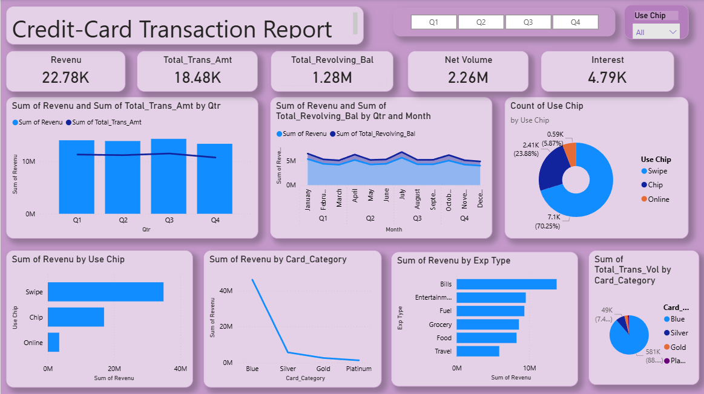

# 💳 Credit Card Transaction Analysis Dashboard | Power BI

## 📌 Project Overview

The **Credit Card Transaction Analysis Dashboard** is an interactive Power BI project designed to analyze credit card transactions, customer spending behavior, revenue generation, and transaction patterns.

The dashboard provides a comprehensive overview of credit card performance through interactive visualizations, key performance indicators (KPIs), and quarterly and monthly analysis.

It helps stakeholders understand transaction trends, identify revenue-generating categories, analyze customer payment preferences, and monitor important financial metrics to support data-driven business decisions.

## 🎯 Project Objectives

- Analyze overall credit card revenue and transaction performance.
- Monitor quarterly and monthly revenue trends.
- Understand customer payment preferences across Swipe, Chip, and Online transactions.
- Analyze revenue contribution across different card categories.
- Evaluate spending patterns across expenditure types.
- Track transaction volume across different card categories.
- Present important business metrics through an interactive dashboard.

## 📊 Dashboard Overview

The dashboard is divided into multiple analytical sections to provide meaningful insights into credit card transactions.

### 1. Key Performance Indicators (KPIs)

The dashboard displays five major performance indicators:

| KPI | Value | Description |
|---|---:|---|
| Revenue | 22.78K | Overall revenue |
| Total Transaction Amount | 18.48K | Total transaction amount |
| Total Revolving Balance | 1.28M | Outstanding revolving balance |
| Net Volume | 2.26M | Net transaction volume |
| Interest | 4.79K | Interest metric |

### 2. Quarterly Revenue & Transaction Analysis

- Compares revenue and total transaction amounts across Q1, Q2, Q3, and Q4.
- Uses a combination of column and line visualizations.
- Helps identify quarterly performance patterns.

### 3. Monthly Revenue & Revolving Balance Analysis

- Analyzes monthly revenue and revolving balance trends.
- Provides a comparison across all 12 months.
- Organizes monthly performance by quarter.
- Helps identify changes in financial performance over time.

### 4. Transaction Distribution by Payment Method

Analyzes transaction counts across three payment methods:

| Payment Method | Transactions | Percentage |
|---|---:|---:|
| Swipe | 7.1K | 70.25% |
| Chip | 2.41K | 23.88% |
| Online | 0.59K | 5.87% |

This visualization helps understand customer preferences for different credit card payment methods.

### 5. Revenue by Payment Method

- Compares revenue generated through Swipe, Chip, and Online transactions.
- Highlights the contribution of each payment method.
- Helps understand payment-channel performance.

### 6. Revenue by Card Category

- Analyzes revenue across different card categories.
- Includes Blue, Silver, Gold, and Platinum cards.
- Helps identify the contribution of each card category to overall revenue.

### 7. Revenue by Expenditure Type

Analyzes revenue generated across different spending categories:

- Bills
- Entertainment
- Fuel
- Grocery
- Food
- Travel

This analysis helps identify major expenditure categories and customer spending patterns.

### 8. Transaction Volume by Card Category

- Compares transaction volume across different credit card categories.
- Uses a donut chart to visualize the distribution.
- Helps understand transaction activity across card types.

## 🎛️ Interactive Dashboard Features

The dashboard includes interactive filtering options:

- **Quarterly Filter:** Filter dashboard data by Q1, Q2, Q3, and Q4.
- **Payment Method Filter:** Analyze data based on Swipe, Chip, and Online transactions.
- **Dynamic Visualizations:** Charts and KPIs respond to the selected filters.
- **Cross-Visual Analysis:** Explore relationships between different transaction metrics.

## 🛠️ Tools & Technologies

- **Microsoft Power BI Desktop** – Dashboard development and data visualization.
- **Power Query** – Data transformation and preparation.
- **DAX (Data Analysis Expressions)** – Measures, calculations, and KPI analysis.
- **Data Modeling** – Organizing data for analytical reporting.

## 💡 Key Business Insights

The dashboard enables the following business observations:

1. Swipe transactions account for the largest share of transaction counts at 70.25%.
2. Chip transactions contribute 23.88% of total transaction counts.
3. Online transactions represent 5.87% of transaction counts.
4. Quarterly analysis allows comparison of revenue and transaction performance across the year.
5. Bills represent the highest revenue-generating expenditure category among the displayed categories.
6. Blue cards account for the largest share of revenue among the displayed card categories.

## 📷 Dashboard Preview

## 🚀 Project Outcomes

Through this project, I gained practical experience in:

- Building interactive business intelligence dashboards.
- Creating and analyzing KPIs.
- Performing time-based and category-based analysis.
- Working with Power BI visualizations.
- Using DAX for analytical calculations.
- Transforming business data into meaningful visual insights.
- Presenting complex information in an easy-to-understand format.

## 👨‍💻 Author

**Prathmesh Bondre**

B.Tech – Computer Technology

**Skills:** Power BI | SQL | Python | Excel | Data Analytics

---

⭐ If you find this project useful, feel free to star this repository!
